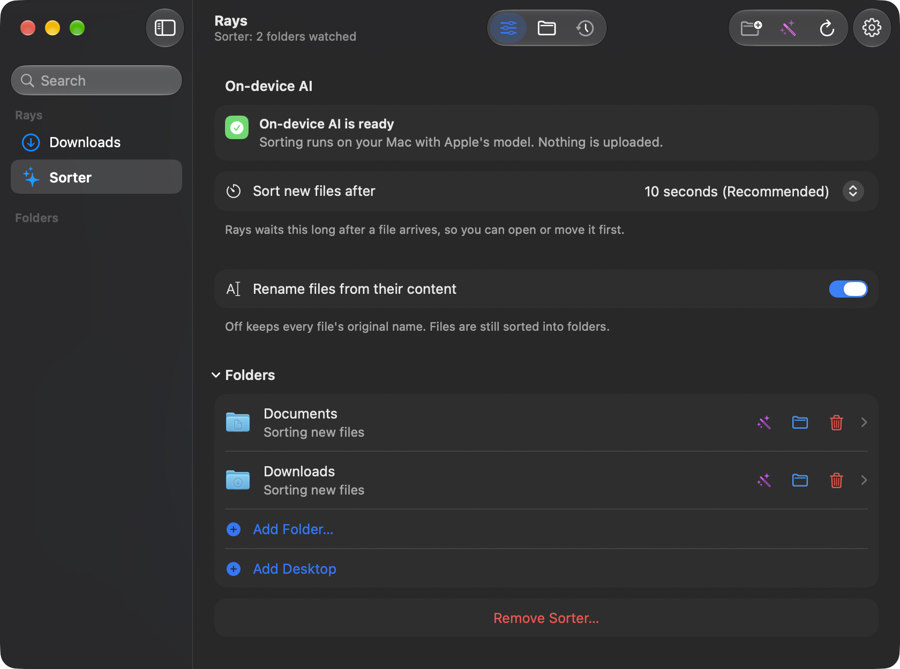

The sorter watches the folders you choose. A few seconds after a new file arrives, it moves it into a folder that fits it, inside the watched folder:

| Folder | What goes there |
|---|---|
| Work | Anything about a business or job: invoices, orders, reports, specs, data exports |
| Personal | Your own documents: IDs, bank statements, receipts, medical, certificates |
| Images | Photos, screenshots, logos, wallpapers |
| Installers | Apps, disk images, packages, VPN profiles |
| Archives | Zip, tar, rar and other compressed files |
| Media | Audio and video |
| Code | Source code and scripts |
| Other | Manuals, articles, ebooks, anything else |

Sorting runs on your Mac with Apple's on-device model. Nothing is uploaded.

## Set up

Open **Sorter** in the sidebar. The **Setup** tab (the sliders icon in the toolbar) has:

- **On-device AI**: shows whether Apple Intelligence is ready.
- **Sort new files after**: how long Rays waits after a file arrives, so you can open or move it first. 10 seconds is recommended.
- **Rename files from their content**: gives files clear names from what is inside them. Turn it off to keep original names; files are still sorted.
- **Folders**: the folders Rays watches. Each row has icons to sort now, show in Finder, and stop watching. Use **Add Folder…** or **Add Desktop** to add more.
- **Remove Sorter…**: stops sorting every folder.

Files that were in a folder before you added it stay where they are. To sort those too, run `dl sort FOLDER --all`.

## Choose where a category goes

Click a folder row to open it. Under **Where files go**, pick a category to send it to another folder (for example Work to `~/Documents/Work`), use the default folder inside, or show it in Finder.

## Browse sorted files

- **Files** tab (the folder icon): your sorted folders as a Finder-style list or as icons. Double-click a folder to open it, or a file to open it in its app.
- **Recent** tab (the clock icon): the latest moves. Click a row to open the file; the magnifier shows it in Finder.

## Update older sorter setups

If you used the sorter before it was built into Rays, the Setup tab shows **Update All**. It switches those folders to the sorter inside Rays. Nothing is moved.
